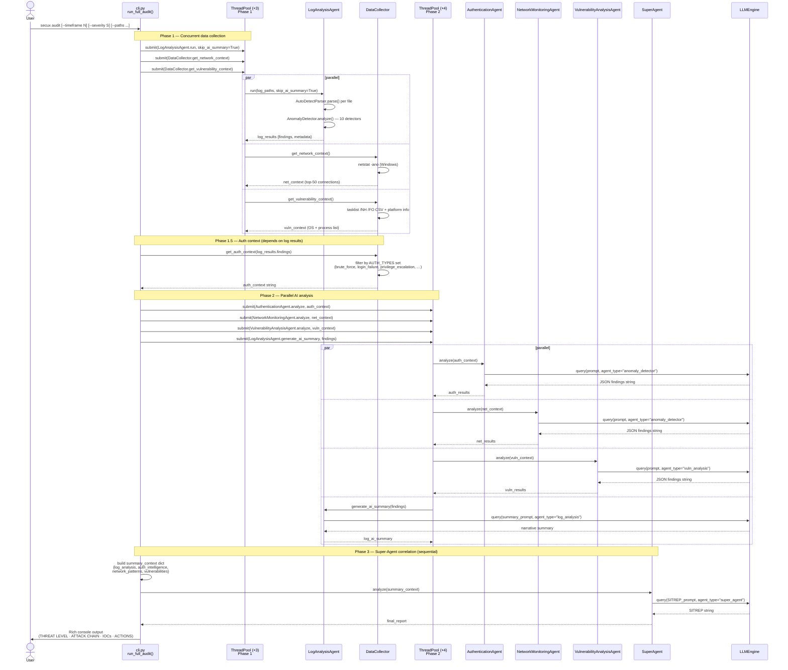
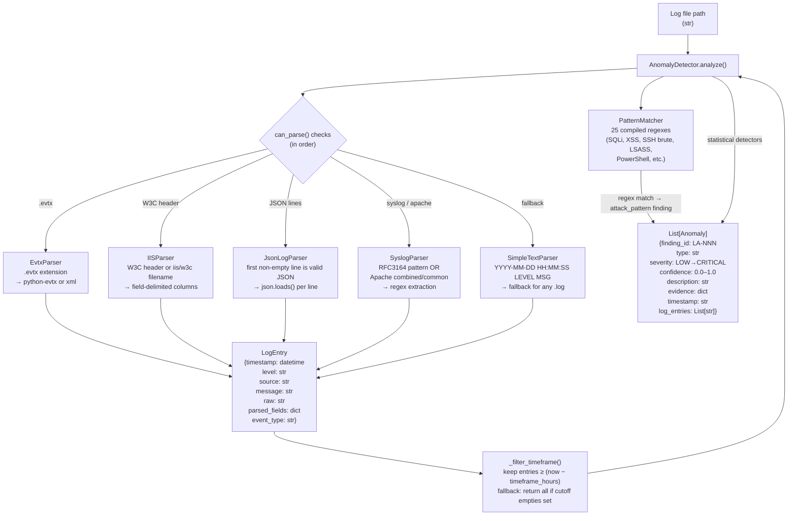
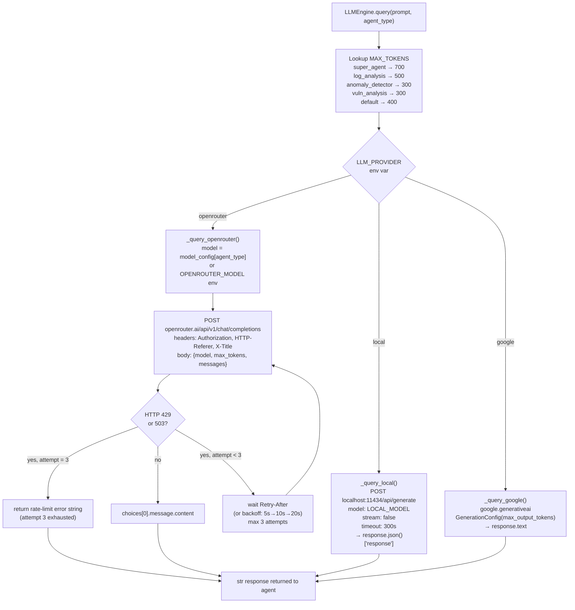

# SecuX — Data Flow

---

## 1. `secux audit` — Full 3-Phase Parallel Orchestration



---

## 2. `secux logscan` — Single Scan

```mermaid
sequenceDiagram
    actor User
    participant CLI as cli.py<br/>run_single_scan()
    participant LA as LogAnalysisAgent
    participant PAR as AutoDetectParser
    participant DET as AnomalyDetector
    participant LLM as LLMEngine
    participant FMT as JSONFormatter

    User->>CLI: secux logscan [-t N] [-s LEVEL] [-o FILE] [-p PATH ...]

    CLI->>CLI: resolve output path<br/>(default: output/secux_logscan_YYYYMMDD_HHMMSS.json)
    CLI->>LA: run(log_paths, output_file, append, show_summary)

    LA->>LA: get_system_config() → discover log paths<br/>(if no --paths given)

    loop for each log file
        LA->>PAR: parse(filepath)
        PAR->>PAR: detect format (EVTX / Syslog / IIS / JSON / Text)
        PAR-->>LA: Iterator[LogEntry]
    end

    LA->>LA: _filter_timeframe(entries)<br/>(keep entries within last N hours;<br/>fallback: keep all if window empties)

    LA->>DET: analyze(entries, timeframe_hours)
    DET->>DET: _update_baseline()
    DET->>DET: run 10 detectors
    DET-->>LA: List[Anomaly]

    LA->>LA: _filter_by_severity(findings)<br/>(drop below --severity threshold)

    LA->>LLM: query(summary_prompt, agent_type="log_analysis")
    LLM-->>LA: ai_summary string

    LA->>FMT: format(agent_name, system_config, logs_accessed,<br/>findings, baseline_metrics, timestamps, …)
    FMT-->>LA: result dict

    LA->>FMT: save_to_file(result, output_file, append)
    LA->>FMT: print_summary(result)

    FMT-->>CLI: Rich console tables + file written
    CLI->>User: "Results saved to: output/secux_logscan_...json"
```

---

## 3. `secux logscan --monitor` — Continuous Monitoring

```mermaid
sequenceDiagram
    actor User
    participant CLI as cli.py<br/>run_monitoring()
    participant LA as LogAnalysisAgent
    participant MON as LogMonitor<br/>(monitor.py)
    participant WD as Watchdog Observer<br/>+ LogFileHandler thread
    participant PAR as AutoDetectParser
    participant DET as AnomalyDetector

    User->>CLI: secux logscan --monitor [-i SECONDS] [-t N]

    CLI->>LA: LogAnalysisAgent(timeframe, severity)
    CLI->>CLI: last_scan = now()

    loop every --interval seconds (Ctrl+C to stop)
        CLI->>LA: run_incremental(log_paths, since=last_scan)
        LA->>PAR: parse each file
        LA->>LA: filter entries where timestamp > since
        LA->>LA: _filter_timeframe()
        LA->>DET: analyze(new_entries, timeframe_hours)
        DET-->>LA: List[Anomaly]
        LA-->>CLI: (new_entries, new_findings)

        alt new events detected
            CLI->>CLI: print counts + top-3 finding descriptions
            CLI->>LA: run(full scan, append=True, show_summary=False)
            CLI->>CLI: print "Updated: <output file>"
        end

        CLI->>CLI: last_scan = now()
        CLI->>CLI: sleep(interval)
    end

    User->>CLI: Ctrl+C
    CLI->>User: "Monitoring stopped."

    note over MON,WD: LogMonitor (used by programmatic API, not CLI --monitor)
    note over MON: LogMonitor.start() sets up Watchdog Observer<br/>+ LogFileHandler polling thread
    note over WD: on file growth → parse new lines →<br/>AnomalyDetector → callback(entries, findings)
```

---

## 4. Log Parsing Pipeline — Internal Flow



---

## 5. LLM Query Lifecycle



---

## 6. Finding Output Schema

Each `Anomaly` produced by the detector pipeline serialises to this JSON structure (via `JSONFormatter`):

```json
{
  "finding_id": "LA-001",
  "type": "brute_force_attempt",
  "severity": "CRITICAL",
  "confidence": 0.95,
  "description": "12 failed login attempts from 192.168.1.50 targeting root",
  "evidence": {
    "source_ip": "192.168.1.50",
    "target_user": "root",
    "event_count": 12,
    "time_window": "00:03:22"
  },
  "timestamp": "2024-01-15T22:14:33+00:00",
  "log_entries": [
    "Jan 15 22:14:31 host sshd[1234]: Failed password for root from 192.168.1.50 port 54321 ssh2",
    "..."
  ]
}
```

---

## 7. Output File Structure

`secux logscan` writes to `output/secux_logscan_YYYYMMDD_HHMMSS.json`:

```json
{
  "agent": "Log_Analysis_Agent",
  "scan_metadata": {
    "hostname": "...",
    "os": "windows",
    "timeframe_hours": 24,
    "processing_duration_seconds": 3.14,
    "data_volume_mb": 12.5,
    "total_entries_analyzed": 4821
  },
  "logs_accessed": [
    {"path": "...", "size": "5.20 MB", "last_modified": "...", "status": "success"}
  ],
  "access_errors": [],
  "timeframe": {"start": "...", "end": "..."},
  "findings": [ ... ],
  "baseline_metrics": { ... },
  "ai_summary": "THREAT SUMMARY: ..."
}
```

Append mode (`--append`) deduplicates by `finding_id` before writing.
