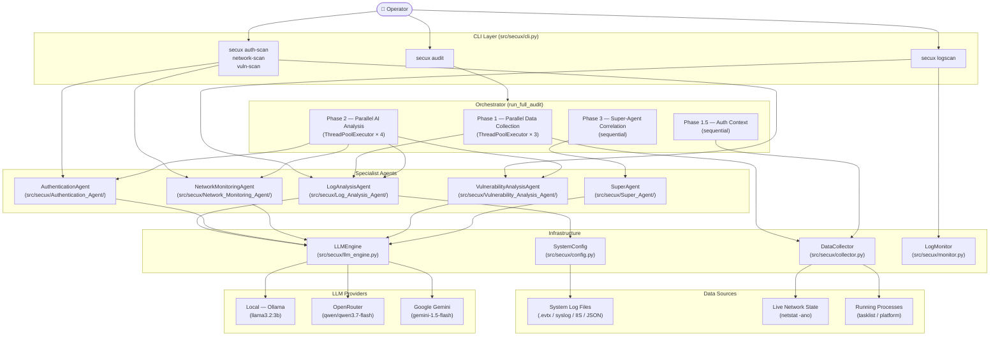
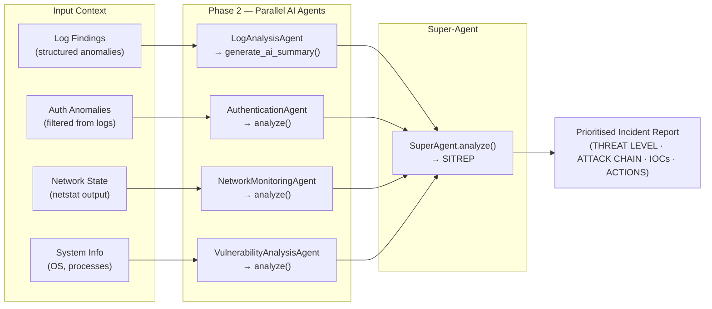

# SecuX — High-Level Design

## 1. Overview

SecuX is a CLI-based, AI-driven security orchestration tool. A single command (`secux audit`) spins up a network of four specialist AI agents in parallel, correlates their findings through a Super-Agent, and produces a prioritised incident report (SITREP) from raw system logs and live OS telemetry — all locally, with no data leaving the machine.

---

## 2. System Architecture

---

## 3. Agent Network

SecuX runs four specialist agents in parallel (Phase 2). Each agent receives a focused context string and returns structured JSON findings via LLM inference.

---

## 4. LLM Abstraction

The `LLMEngine` provides a single `.query(prompt, agent_type)` interface over three pluggable backends, selected by the `LLM_PROVIDER` environment variable.

| Provider | Env var | Default model | Token cap (super_agent) |
|---|---|---|---|
| `local` | `LOCAL_MODEL`, `LOCAL_LLM_URL` | `llama3.2:3b` via Ollama | 700 |
| `openrouter` | `OPENROUTER_API_KEY`, `OPENROUTER_MODEL` | `qwen/qwen3.7-flash` | 700 |
| `google` | `GEMINI_API_KEY` | `gemini-1.5-flash` | 700 |

Per-agent token caps enforce cost/latency budgets: `super_agent=700`, `log_analysis=500`, `anomaly_detector=300`, `vuln_analysis=300`.

---

## 5. Data Sources

| Source | Collection method | Used by |
|---|---|---|
| Windows `.evtx` logs | `python-evtx` or `AutoDetectParser` | `LogAnalysisAgent` |
| Linux `/var/log/*` | File read + `SyslogParser` | `LogAnalysisAgent` |
| IIS W3C logs | `IISParser` | `LogAnalysisAgent` |
| Newline-delimited JSON logs | `JsonLogParser` | `LogAnalysisAgent` |
| Active network connections | `netstat -ano` (Windows) | `NetworkMonitoringAgent` |
| Running processes + OS info | `tasklist` + `platform` module | `VulnerabilityAnalysisAgent` |
| Auth anomalies | Filtered from log findings | `AuthenticationAgent` |

Nothing is transmitted to external services — LLM calls go to whichever provider is configured (local by default).

---

## 6. CLI Commands Summary

| Command | Mode | Key behaviour |
|---|---|---|
| `secux audit` | Full parallel orchestration | 3-phase parallel audit → SITREP |
| `secux logscan` | Single scan | Log parse → anomaly detect → JSON report |
| `secux logscan --monitor` | Continuous | Watchdog + polling loop, incremental scan every N seconds |
| `secux auth-scan <data>` | Standalone | Direct `AuthenticationAgent.analyze()` call |
| `secux network-scan <data>` | Standalone | Direct `NetworkMonitoringAgent.analyze()` call |
| `secux vuln-scan <data>` | Standalone | Direct `VulnerabilityAnalysisAgent.analyze()` call |
| `secux logscan --list-logs` | Diagnostic | Lists discovered log files and their status |
