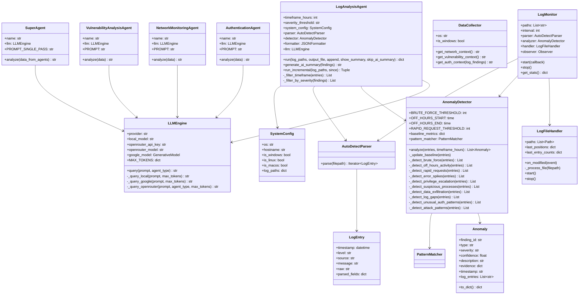
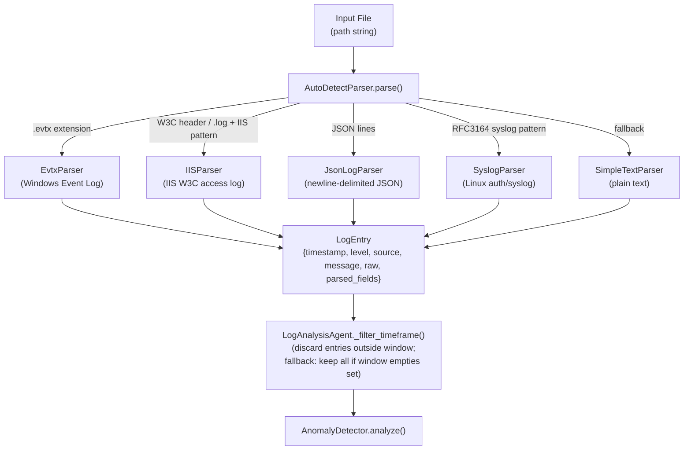
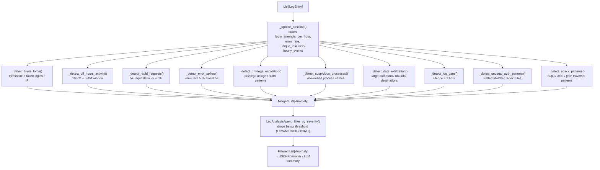
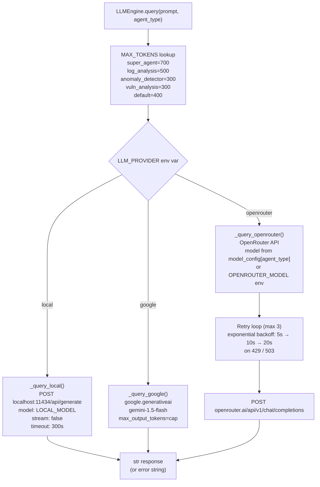

# SecuX — Low-Level Design

## 1. Module Map

```
src/secux/
├── cli.py                          # Click CLI entry point, orchestration logic
├── config.py                       # SystemConfig dataclass, OS-specific log paths
├── collector.py                    # DataCollector — live OS telemetry
├── monitor.py                      # LogMonitor + LogFileHandler (watchdog)
├── llm_engine.py                   # LLMEngine — unified LLM abstraction
├── Log_Analysis_Agent/
│   ├── agent.py                    # LogAnalysisAgent
│   ├── parsers/
│   │   ├── autodetect.py           # AutoDetectParser — format routing
│   │   ├── base.py                 # LogEntry dataclass
│   │   ├── syslog.py               # RFC3164 syslog parser
│   │   ├── evtx.py                 # Windows .evtx parser
│   │   ├── iis.py                  # IIS W3C access log parser
│   │   ├── json_log.py             # Newline-delimited JSON parser
│   │   └── simple_text.py          # Plain-text fallback parser
│   ├── analyzers/
│   │   ├── anomaly.py              # AnomalyDetector + Anomaly dataclass
│   │   └── patterns.py             # PatternMatcher — regex/heuristic rules
│   └── output/
│       └── json_formatter.py       # JSONFormatter — structured output + Rich summary
├── Authentication_Agent/agent.py   # AuthenticationAgent
├── Network_Monitoring_Agent/agent.py # NetworkMonitoringAgent
├── Vulnerability_Analysis_Agent/agent.py # VulnerabilityAnalysisAgent
└── Super_Agent/agent.py            # SuperAgent
```

---

## 2. Class Diagram



---

## 3. Parser Auto-Detection Pipeline

The `AutoDetectParser` inspects file extension and content to route to the correct format-specific parser. All parsers yield `LogEntry` objects.



---

## 4. Anomaly Detection Pipeline

`AnomalyDetector.analyze()` runs 10 sequential detection passes over the filtered `LogEntry` list and collects `Anomaly` objects.



---

## 5. LLM Engine Internals



---

## 6. DataCollector Methods

| Method | Command / source | Returns | Limit |
|---|---|---|---|
| `get_network_context()` | `netstat -ano` (Windows) | LISTENING + ESTABLISHED lines | Top 50 lines |
| `get_vulnerability_context()` | `tasklist /NH /FO CSV` + `platform` | OS info + unique process names | Top 40 processes |
| `get_auth_context(log_findings)` | Filters `List[dict]` from log scan | Auth-related finding strings | Top 20 findings |

Auth-related finding types matched: `brute_force_attempt`, `login_failure`, `login_success`, `off_hours_login`, `off_hours_activity`, `high_failure_ratio`, `privilege_escalation`, `privilege_assign`.

---

## 7. Config — OS Log Path Discovery

`get_system_config()` calls `_get_log_paths(system)` based on `platform.system()`:

| OS | Log paths auto-discovered |
|---|---|
| Windows | `Security.evtx`, `System.evtx`, `Application.evtx`, `Setup.evtx`, IIS `W3SVC1/` |
| Linux | `auth.log`, `syslog`, `secure`, `messages`, `kern.log`, Apache, MySQL, fail2ban |
| macOS | `system.log`, `secure.log`, `/var/log/asl/` |

`get_available_log_files()` stats each path — returns `status: "success"` or `"failed"` per path.

---

## 8. Severity Levels

| Level | Integer rank | Meaning |
|---|---|---|
| `LOW` | 0 | Informational / weak signal |
| `MEDIUM` | 1 | Suspicious, warrants review |
| `HIGH` | 2 | Active attack indicator |
| `CRITICAL` | 3 | Confirmed breach / immediate action required |

The `--severity` flag sets the minimum rank; findings below it are discarded before the AI summary and output.
